# Additional instance segmentation quality metrics for FTW models

FTW's current measures for evaluating model instance segmentation performance include object precision, recall and F1, which use a fixed IoU threshold (typically 0.5) to match predicted and reference fields. The FTP codebase further adds panoptic quality (PQ), which multiplies object detectability (RQ, a synonym for object F1) with segmentation quality (SQ, the mean IoU of matched objects), along with the symmetric boundary Chamfer distance, a measure of how close matched predicted and reference field boundaries are to one another.

All of these measures depend on an IoU threshold that determines which reference and predicted fields qualify as object matches. IoU is defined as 

$$\operatorname{IoU}(G_i,P_j)=u_{ij}=\frac{n_{ij}}{a_i+b_j-n_{ij}}$$

Where $a_i$ is the area of the *i*th reference field (G), $b_j$ is the area of the *j*th predicted field (P), and $n_{ij}$ the area of intersection between $G_i$ and $P_j$, measured as pixel counts on aligned masks. Under threshold-based object matching (typically, $u_{ij}>0.5$), $M$ is the set of one-to-one matches. 

Factors that prevent matches under the IoU definition can arise from splits, merges and boundary errors, not only from failing to detect fields where they exist, or from detecting fields where none exist. Several additional metrics are proposed to help distinguish these aspects of segmentation quality, including cases where reference and predicted fields overlap but fail to satisfy the matching threshold. These can be distinguished within three broad groups: area-weighted best overlap, measures of partition, and boundary distance.

## 1. Added metrics

### 1.1 Area-weighted best overlap

Two of the proposed measures use the highest IoU between reference and predicted fields, without requiring it to exceed a matching threshold. One of these is *recovery*:

$$\mathrm{Recovery}=\frac{\sum_i a_i\max_j u_{ij}}{\sum_i a_i}$$

Which is related to object recall, but selects one best-overlapping prediction per reference ($\max_j u_{ij}$), allowing several references to select the same prediction. Recovery averages best IoU weighted by reference area, so larger fields contribute more than small ones. It is not simply the fraction of reference pixels recovered: IoU also penalizes extra predicted area.

*Support* reverses the direction, assessing how well the matched area of predicted fields corresponds to reference fields:

$$\mathrm{Support}=\frac{\sum_j b_j\max_i u_{ij}}{\sum_j b_j}$$

Making it related to object precision.

### 1.2 Partitioning: Rand split and merge

These two measures provide additional information on whether fields are over- or under-segmented. The former is described by *Rand split*:

$$\mathrm{Rand}_{split}=\frac{\sum_i\sum_j n_{ij}^{2}}{\sum_i a_i^{2}}$$

When a reference field is split across two or more predictions, squared intersections decrease, leading to a lower split score, which is an indicator (albeit not a pure one) of over-segmentation. A high split score specifically means that reference-field area remains together within predictions; it does not guarantee close boundary alignment, since a larger merged prediction can also retain that area. Missed reference area can lower the split score even without over-segmentation.

In the opposite direction, combining several references within one prediction reduces the merge score.

$$\mathrm{Rand}_{merge}=\frac{\sum_i\sum_j n_{ij}^{2}}
{\sum_j\left(\sum_i n_{ij}\right)^{2}}$$

Its denominator uses predicted area **on reference foreground**–not all predicted area–so it does not replace precision or support, and large intersections have greater influence. If no reference fields exist, merge is undefined, whereas if references exist but no prediction overlaps them, merge is defined as zero. Perfect merge scores can occur when only one reference field is accurately delineated, so merge (as well as split) should be interpreted in conjunction with other object quality measures.

### 1.3 Boundary distance and coverage

FTP's symmetric boundary Chamfer distance measures the mean nearest-neighbor distance between the boundary points of reference and predicted fields, averaging the distances calculated in both directions:

$$
C(G,P)=\frac{1}{2}\left[
\frac{\sum_{x\in B(G)}\min_{y\in B(P)}d(x,y)}{|B(G)|}
+
\frac{\sum_{y\in B(P)}\min_{x\in B(G)}d(y,x)}{|B(P)|}
\right]
$$

where $B(G)$ and $B(P)$ are the raster boundary-point sets of the reference and predicted fields, respectively, $d(x,y)$ is the distance between two points in metres, and $|\cdot|$ denotes the cardinality (number of elements) of a set. The distance $C(G,P)$ is undefined if either boundary-point set is empty. Boundary points are identified using FTP's interior distance-transform rule (distance to background less than 1.5 pixels), including internal holes and retaining FTP's treatment of chip edges. For geographic rasters, distances in metres are calculated using locally constant geodesic row and column spacing estimated at the chip centre, rather than calculating exact geodesic distances between individual boundary-point pairs.

We refer to the mean Chamfer distance calculated over threshold-matched field pairs as *Threshold Chamfer* ($C_T$). This measure uses the same matching criterion as SQ. With $M$ being the set of one-to-one matched field pairs satisfying $u_{ij}>0.5$, Threshold Chamfer is calculated as:

$$
C_T=\frac{\sum_{(i,j)\in M}C(G_i,P_j)}{|M|}
$$

To extend the measure to fields that overlap but do not necessarily meet the matching threshold, we define, for each reference field $i$, the index of its best-overlapping predicted field as

$$
j^*(i)=\arg\max_j u_{ij}
$$

And the set of reference fields that overlap at least one predicted field as

$$
O=\{i:\max_j u_{ij}>0\}.
$$

These allow for an alternative boundary distance measure, *Best-IoU Chamfer* ($C_B$), which is calculated between each reference field and its best-overlapping predicted field, extending boundary assessment to overlapping fields that failed object matching:

$$
C_B=\frac{\sum_{i\in O}C(G_i,P_{j^*(i)})}{|O|}
$$

Unlike Threshold Chamfer, Best-IoU Chamfer allows multiple reference fields to match the same predicted field. Exact IoU ties are resolved by selecting the lowest compact prediction ID (instance IDs reassigned to be contiguous). Unlike recovery, each contributing field pair is weighted equally in both Chamfer measures. Pairs with an empty boundary set are excluded from both the numerator and denominator, and each measure is undefined when no qualifying distances remain. References without threshold matches do not contribute to $C_T$, while zero-overlap references do not contribute to either measure. Consequently, $C_T$ should be interpreted alongside object recall and $C_B$ alongside coverage.

The fraction of reference fields with at least one overlapping predicted field is defined as:

$$
\mathrm{Coverage}_B=\frac{|O|}{N_G}
$$

Coverage is calculated independently of boundary-point availability.

## 2. Metric complementarity

To assess whether the additional metrics provide complementary information for assessing model object extraction performance, we undertook several analyses of the new and existing metric values calculated from PRUE-b7's predictions on FTW v1's test split. Given known issues with reference field fragmentation within the semantic masks, we drew reference fields from the **instance** labels when calculating object metrics, in order to keep together separated pixels representing the same field based on their instance IDs. This approach deviates from the current method in which reference instances are derived from semantic masks (see Appendix for comparison of correlations calculated under both methods), but is likely to more closely represent true model performance, particularly with respect to object recall. We excluded Denmark because its instance IDs often combine disconnected fields, as well as the presence-only countries of Brazil, India, Kenya, and Rwanda, which do not support assessments based on false-positives.

### 2.1 Correlations between metrics

The first assessment was an analysis of the correlations between chip-level metric scores using Spearman's rank correlation. This analysis showed that recovery and PQ (0.81), recovery and object recall (0.79), support and PQ (0.74), and support and object precision (0.69) have the strongest pairwise correlations between existing and new measures. These are comparable to or lower than the pairwise associations between PQ and the two existing object measures (0.80–0.90), which is expected given that both are contained within PQ. The two Chamfer variants correlate at 0.64, while the added Rand measures (with the exception of the split–PQ relationship; 0.58), have absolute correlations of less than 0.5 with existing metrics. The strongest associations among the introduced metrics are between recovery and support (0.76), recovery and split (0.68), the two Chamfer variants (0.64), merge and Best-IoU Chamfer (−0.62), and recovery and merge (0.60).

**Table 1. Spearman correlations.** P = object precision; R = object recall; Rec = recovery; Sup = support; CT = threshold Chamfer; CB = best-IoU Chamfer; Cov = best-IoU reference coverage. Smaller Chamfer is better, hence its generally negative relationships with quality scores. Pairwise sample sizes range from 5,282 to 5,702 and are provided in the [count matrix](figures/reference-metrics-revision/spearman-counts.csv). F1/RQ is not duplicated in this matrix; SQ is PQ's matched-overlap component, not an unrelated new source of information.

|       | P     | R     | SQ    | PQ    | Rec   | Sup   | Split | Merge | CT    | CB    | Cov  |
|-------|-------|-------|-------|-------|-------|-------|-------|-------|-------|-------|------|
| P     | —     | 0.53  | 0.36  | 0.80  | 0.50  | 0.69  | 0.45  | 0.16  | -0.08 | -0.24 | 0.22 |
| R     | 0.53  | —     | 0.44  | 0.90  | 0.79  | 0.55  | 0.46  | 0.48  | -0.15 | -0.46 | 0.65 |
| SQ    | 0.36  | 0.44  | —     | 0.61  | 0.65  | 0.61  | 0.48  | 0.42  | -0.35 | -0.23 | 0.17 |
| PQ    | 0.80  | 0.90  | 0.61  | —     | 0.81  | 0.74  | 0.58  | 0.44  | -0.19 | -0.40 | 0.54 |
| Rec   | 0.50  | 0.79  | 0.65  | 0.81  | —     | 0.76  | 0.68  | 0.60  | -0.21 | -0.41 | 0.46 |
| Sup   | 0.69  | 0.55  | 0.61  | 0.74  | 0.76  | —     | 0.51  | 0.47  | -0.18 | -0.35 | 0.17 |
| Split | 0.45  | 0.46  | 0.48  | 0.58  | 0.68  | 0.51  | —     | 0.14  | 0.07  | 0.10  | 0.45 |
| Merge | 0.16  | 0.48  | 0.42  | 0.44  | 0.60  | 0.47  | 0.14  | —     | -0.35 | -0.62 | 0.09 |
| CT    | -0.08 | -0.15 | -0.35 | -0.19 | -0.21 | -0.18 | 0.07  | -0.35 | —     | 0.64  | 0.09 |
| CB    | -0.24 | -0.46 | -0.23 | -0.40 | -0.41 | -0.35 | 0.10  | -0.62 | 0.64  | —     | 0.06 |
| Cov   | 0.22  | 0.65  | 0.17  | 0.54  | 0.46  | 0.17  | 0.45  | 0.09  | 0.09  | 0.06  | —    |

These results suggest that the added measures provide varying degrees of complementarity to the existing metrics. Although some are strongly associated, none of the introduced measures has near-perfect rank correlation with an existing one. The moderate to weak associations between the added Chamfer and Rand measures with most existing metrics suggest that these measures may provide particularly complementary information. It should be noted, however, that Spearman correlation quantifies monotonic associations between metric scores and is less sensitive to outliers than Pearson correlation, and that pairwise rank correlations cannot fully establish the extent of information redundancy among measures. Furthermore, the strengths of these correlations may depend on variations in the distributions of field characteristics within and across the test chips.

### 2.2 Differences between paired metrics

To further examine the degree of metric complementarity, two additional analyses of the contrast between selected pairs of the most closely-related added and existing measures were also explored. The first included the distributions of within-chip score differences, as shown in Figure 1.

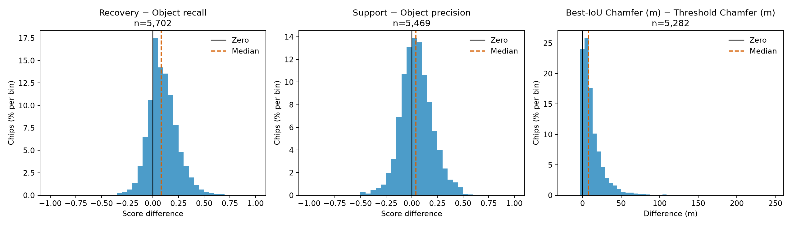

*Figure 1. Distributions of within-chip differences, with lines illustrating zero and the median difference. Bars show the percentage of pairwise-defined chips in each bin. Chamfer differences are in metres; other differences are unitless. Absolute differences below 1e-9 are treated as numerical equality.*

Recovery exceeds recall by a median of **0.082** (interquartile range 0.000–0.178), while support exceeds precision by **0.041** (−0.051–0.143). These findings illustrate that the two new scores based on area-weighted best overlap typically, but not uniformly, give a more favourable assessment of model performance, with some important distinctions. Negative differences can arise when many objects pass the matching threshold while their overlap remains imperfect, or when larger objects are mapped less well than smaller ones. Comparing the two boundary error measures, Best-IoU Chamfer exceeds Threshold Chamfer by a median of **7.77 m** (2.62–16.66 m), is larger in 82.5% of chips, nearly equal in 16.9%, and smaller in 0.6%.

The second approach was to examine the scatter of per-chip metric pairs (Figure 2), from which we selected chips that help to illustrate the constrasts and similarities between the different metrics.

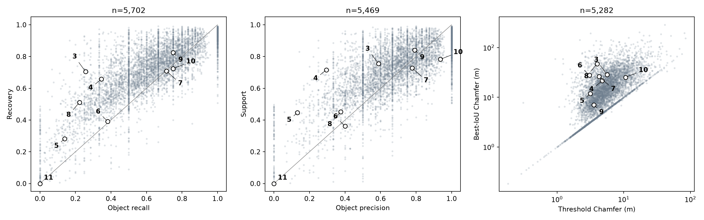

*Figure 2. Chip-level comparisons using instance references. Numbered points identify the maps in Figures 3–11. Sample sizes differ because undefined scores are not imputed. Figure 11 occurs at the origin of the first two panels but has no defined Chamfer. Equality lines are shown for recall/recovery and precision/support; Chamfer axes are linear below 1 m and logarithmic above it.*

To visualize how reference and model-predicted fields vary in relation to their metrics, we show each set of boundaries separately on the Window A image, followed by the threshold-based matching overlays, with blue showing matched predictions, bright-red showing unmatched predictions (false positives) and dashed-orange unmatched references (false negatives). Chips were selected from groups having contrasting scores of **\>0.7 / \<0.3** for the unitless measures, with separately stated metre thresholds for Chamfer, and drawn from near the centre of within-group ranks. Each example has at least 20 reference fields. Captions list the percentages of chips within the contrast group; chips with undefined criteria do not satisfy group membership. The minimum field count applies only to illustration selection, not these percentages.

### 2.3 Visualizations

#### 2.3.1 Area-weighted best overlaps

#### 2.3.1.1 High recovery, low object recall

In an example from Spain (Figure 3), recovery is 0.71 but recall is 0.26, a result of the large fields being correctly mapped, and thus contributing much of the area-weighted agreement, while many reference objects fail to match at the IoU 0.5 threshold.

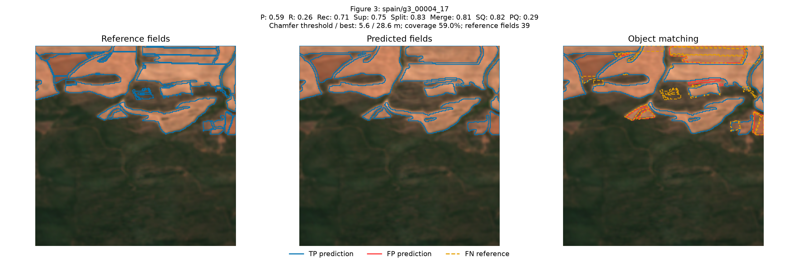

*Figure 3. Recovery >0.7 and recall <0.3: 31/6,824 chips (0.45%).*

#### 2.3.1.2 High support, low object precision

In a second example from Spain (Figure 4), support is 0.72 while object precision is 0.295. Small unmatched predictions count equally against precision but contribute little to support; others can fail because of poor overlap or partitioning.

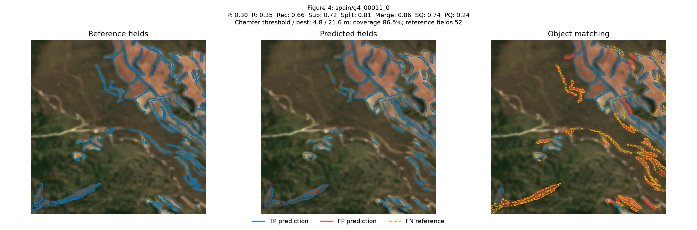

*Figure 4. Support >0.7 and precision <0.3: 11/6,824 chips (0.16%).*

Note that in both of the examples above (and some below), reference and predicted fields often overlap but fail to match in both directions, resulting in reductions to both object recall and precision. In contrast, recovery and support retain partial IoU without imposing the matching threshold, and weight contributions by reference and predicted area, respectively. This can reduce the effect of object-matching failures, particularly for small objects.

#### 2.3.2 Rand measures

#### 2.3.2.1 Over- and incomplete segmentation

In a densely cropped Austrian landscape (Figure 5), Rand split is low (0.21), indicating that many of the 331 reference fields are either split across two or more predictions, only partially covered by predictions, or missed completely. Recall of 0.14 and recovery of 0.28 make clear that this is not simply an example of too many cuts through otherwise recovered fields. In contrast, Rand merge is high (0.93), as the reference-intersecting predicted fields largely overlap just a single reference, rather than joining different references.

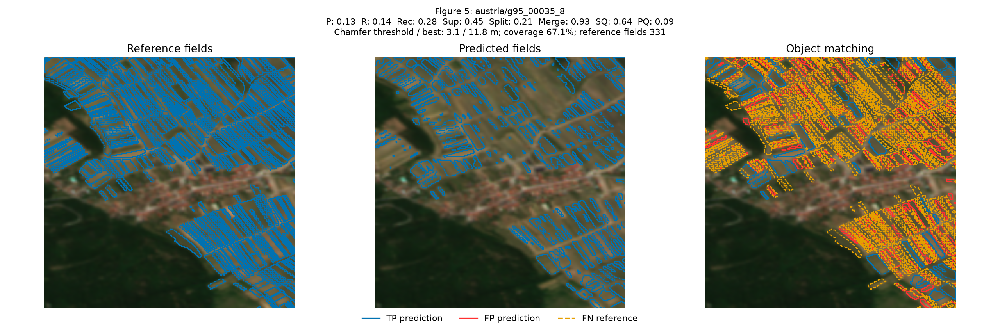

*Figure 5. Rand split <0.3 and merge >0.7: 221/6,824 chips (3.24%).*

#### 2.3.2.2 Under-segmentation

In an example from Croatia (Figure 6), the unmatched predicted fields (in red) combine several fields that are counted as unmatched references (orange outlines). Because predictions combine reference fields rather than preserving their divisions, merge is low (0.22). Furthermore, the merged predictions lower the best IoUs of their constituent reference fields, contributing to a relatively low recovery of 0.39, which is close to the object recall value. In contrast, split remains relatively high because much of the reference-field area is retained together within individual predictions, despite the loss of divisions between fields. Of interest in this example is an apparent reference label error, where what appears to be a field below the single large prediction is delineated by the model, but is absent in the reference.

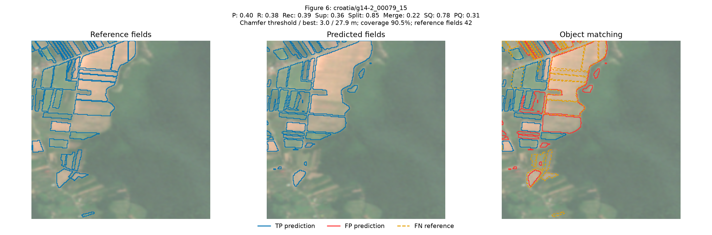

*Figure 6. Rand split >0.7 and merge <0.3: 29/6,824 chips (0.42%).*

#### 2.3.3 Chamfer measures

Two examples help to illustrate the differences in the Chamfer measures. Best-IoU Chamfer extends boundary assessment beyond successful detection, as Threshold Chamfer can look favorable because it excludes harder, lower-overlap pairs. Best-IoU Chamfer extends boundary assessment to each overlapping reference field's best-overlapping prediction, including pairs below the object-matching threshold. In Figure 7, from Luxembourg, Threshold Chamfer is 4.3 m, compared with 26.2 m for best-IoU Chamfer, which includes overlapping reference-prediction pairs that did not meet the matching threshold. In Figure 8, an example of a more extreme contrast from Sweden with relatively high coverage (74.1%) and intermediate recovery (0.51), a relatively small number (6) of good matches returns a Threshold Chamfer distance of 4.0 m, which conceals the lower correspondence among 14 additional overlapping pairs that raise best-IoU Chamfer to 47.1 m. In this case, neither Chamfer describes the seven references without overlapping predictions.

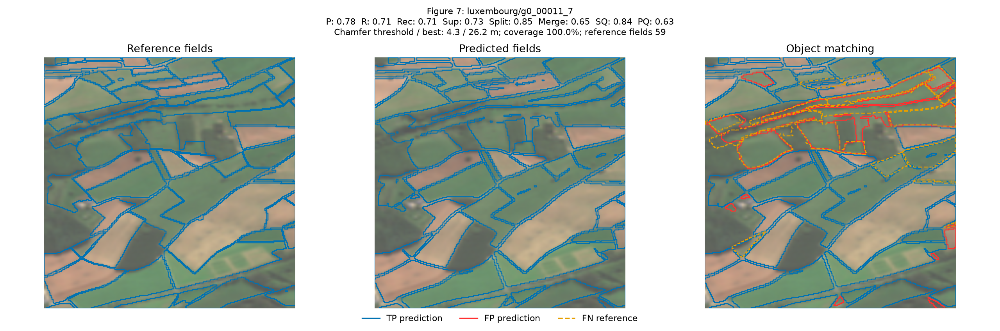

*Figure 7. Threshold Chamfer ≤5 m and Best-IoU Chamfer ≥20 m: 357/6,824 chips (5.23%).*

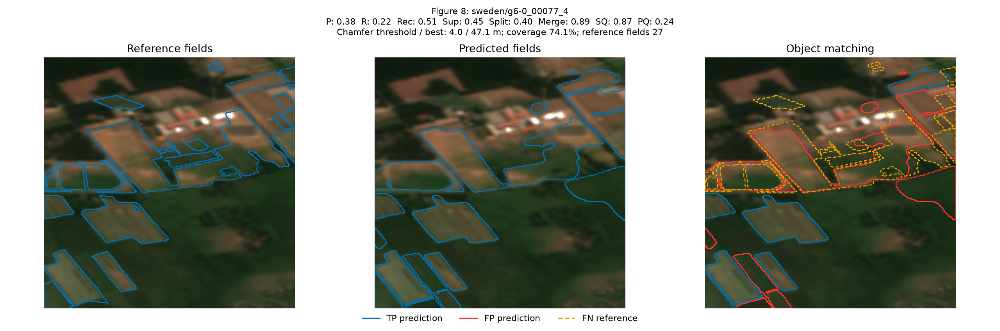

*Figure 8. A more extreme example of between-Chamfer differences, where Threshold Chamfer is 4 m and Best-IoU Chamfer distance is 47.01 m, with at least 20 reference fields.*

Overall, there are 357 cases **(5.23%)** in the test set where Threshold Chamfer distance is ≤5 m and best-IoU Chamfer distance is ≥20 m.

#### 2.3.4 Evaluating multiple measures

The examples above mostly focus on illustrating the contrasts between metric pairs, but considering the combined set of measures helps to further improve understanding of instance segmentation quality.

#### 2.3.4.1 High quality segmentation

Multiple measures converging towards 1 (or towards 0 for Chamfer measures) indicates increasing object segmentation quality, as shown in an example from Austria (Figure 9), where the majority of 56 reference fields are matched by predictions. Coverage is 100%, recall is 0.75, and the two distances are ≤5 and ≤10 m, while object precision and recall, recovery, support, both Rand scores, and SQ \>0.7. These conditions occur in **603 chips (8.84%)**. Note this chip's PQ is 0.66 because it multiplies detection and matched overlap.

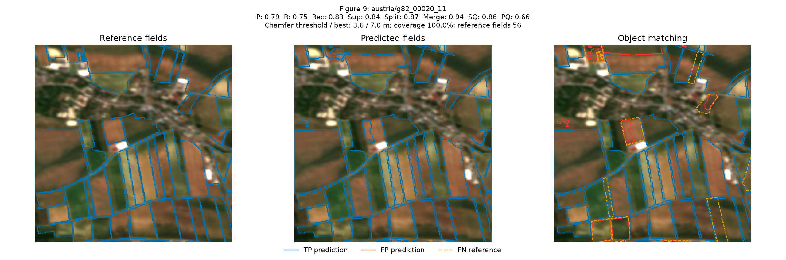

*Figure 9. Precision, recall, recovery, support, both Rand scores and SQ >0.7, with Threshold Chamfer ≤5 m and Best-IoU.*

#### 2.3.4.2 High quality, poorly placed boundaries

An example from France (Figure 10) with high object precision (0.94) and recall (0.75), recovery (0.72), support (0.78), and Rand scores (≥0.67) has relatively high Chamfer distances (10.7–25.4 m), indicating good object matching performance but  discrepancies between predicted and reference boundaries.

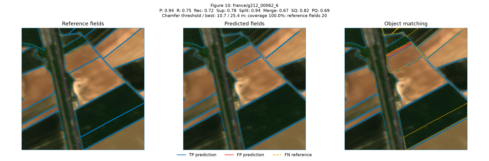

*Figure 10. Precision and recall >0.7 with Threshold Chamfer ≥10 m.*

#### 2.3.4.3 Complete failure

In the final example (Figure 11) from Slovenia, none of the predictions overlaps the 33 reference fields. The detection, overlap and partitioning scores are zero, while SQ and both Chamfers are undefined due to lack of matches (assigning zero distance would indicate perfect boundary placement).

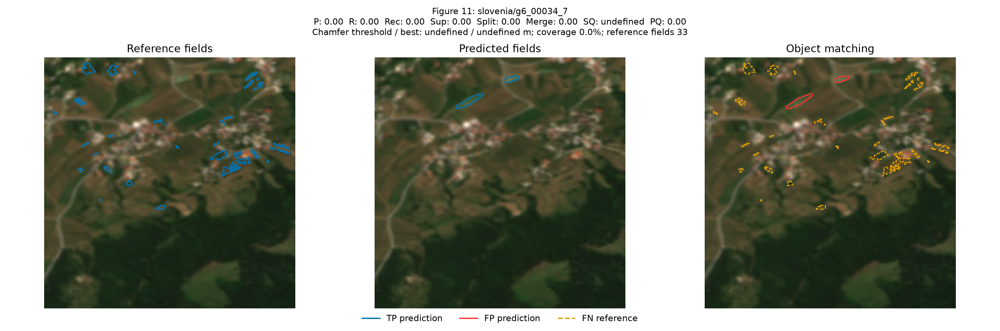

*Figure 11. Precision, recall, recovery, support and both Rand scores <0.3: 36/6,824 chips (0.53%). This is the only member with at least 20 references, so it illustrates one form of failure rather than all low-scoring maps.*

In a correctly delineated map, detection, overlap and partitioning scores should approach one and both Chamfers should approach zero. Differences between paired measures should then disappear, but agreement alone does not establish quality, and improvement does not necessarily result in steady convergence. For example, finding small fields can increase recall more than recovery, while modest boundary improvements can push many fields above the matching threshold. Correcting merges changes several aspects of quality at once.

## 3. Summary

The added measures provide useful, complementary information to FTW/FTP's existing suite of object-based measures. Recovery/support distinguish area-weighted overlap from field counts, the Rand scores distinguish preservation from separation, and Best-overlap Chamfer expresses the boundary discrepancy in metres between each overlapping reference field and its best-IoU prediction. Combined together these measures can provide a deeper understanding of instance segmentation errors, and thus model performance. 

## Appendix A.

### A.1 Comparison of reference extraction methods

The following table compares pair-wise correlations between measures calculated when extracting reference fields from the semantic masks, versus those drawn from instances. Denmark and presence-only countries were excluded from the analysis.

| Pair                         | Semantic components | Supplied instance IDs |
|------------------------------|--------------------:|----------------------:|
| Recall / recovery            |               0.665 |                 0.738 |
| Precision / support          |               0.662 |                 0.657 |
| Rand split / merge           |               0.031 |                −0.015 |
| Threshold / best-IoU Chamfer |               0.586 |                 0.639 |

